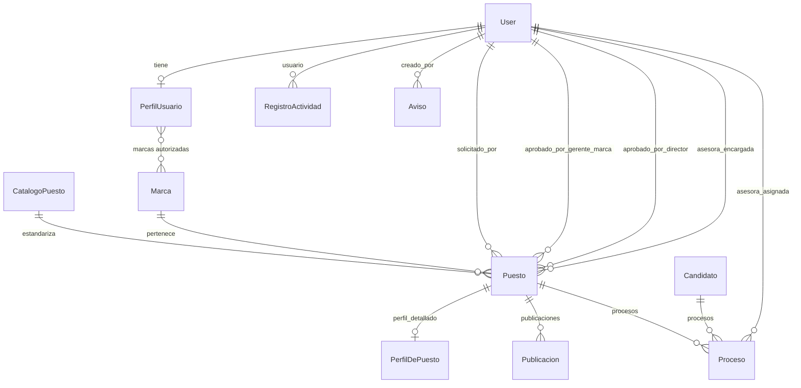
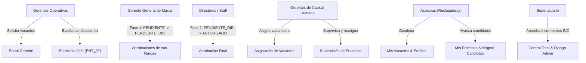

# CONTEXTO TÉCNICO Y OPERATIVO DEL SISTEMA: HR MANAGEMENT (PREMIER AUTOMOTRIZ)

> **PROPÓSITO DE ESTE DOCUMENTO:**  
> Este archivo está especialmente estructurado para que cualquier Inteligencia Artificial o desarrollador de software comprenda de manera integral la arquitectura, modelo de datos, lógica de negocio, flujo de aprobación, permisos y mejores prácticas implementadas en este sistema, permitiendo realizar modificaciones, refactorizaciones o agregar nuevas funciones de forma segura y consistente.

---

## 1. VISIÓN GENERAL DEL SISTEMA

### 1.1 Objetivo del Negocio
**HR Management - Premier Automotriz** es un sistema corporativo tipo **ATS (Applicant Tracking System)** y gestión de recursos humanos diseñado a medida para el grupo automotriz **Premier Automotriz** (distribuidor multimarca en México: *Toyota, Honda, Hyundai, Kia, Chevrolet* y diversas unidades de negocio automotrices como agencias de ventas, talleres de servicio, refacciones y hojalatería y pintura - HyP).

El sistema digitaliza y audita:
1. **Requisición y Aprobación de Vacantes:** Creación por gerentes operativos, con doble flujo de autorización (Gerente General de Marca y Dirección) y reglas estrictas de segregación de funciones.
2. **Atracción y Bolsa de Trabajo:** Portal público de vacantes, postulación y recepción de CVs con validación estricta de formato/tamaño, y base de talento reciclable.
3. **Pipeline Operativo de Selección:** Seguimiento paso a paso del candidato por 12 etapas operativas, traspasos entre asesoras y evaluaciones por parte del jefe inmediato.
4. **Acuerdos de Nivel de Servicio (SLA):** Tiempos meta parametrizados por puesto (10, 12, 20, 25, 30 días) con reloj dinámico, alertas preventivas y control de plazas múltiples.
5. **Business Intelligence & Reporting:** Suite ejecutiva con capa de servicios (*Service Layer*), caché optimizada, embudo de selección, matriz de agencias, monitoreo de carga de asesoras y exportación multivariable a CSV.

---

## 2. STACK TECNOLÓGICO Y DEPENDENCIAS

| Capa | Tecnología | Versión | Propósito / Configuración |
| :--- | :--- | :--- | :--- |
| **Lenguaje** | Python | 3.11+ | Entorno virtual en `.venv` |
| **Framework Web** | Django | 5.2.2 | Núcleo MVC / MTV, ORM, Auth y Admin |
| **Base de Datos Local** | SQLite | 3.x | Archivo local `db.sqlite3` |
| **Base de Datos Prod** | PostgreSQL / dj-database-url | 2.9.10 | AWS RDS / Heroku (`DATABASE_URL`) |
| **Tema Admin** | django-jazzmin | 3.0.1 | Interfaz corporativa limpia para el Django Admin |
| **Caché** | LocMemCache / Redis | Django core | Caché de 15 min en consultas analíticas de reportes |
| **Archivos Estáticos** | WhiteNoise | 6.12.0 | Gestión comprimida de estáticos (`CompressedManifestStaticFilesStorage`) |
| **Servidor WSGI** | Gunicorn | 22.0.0 | Despliegue en contenedor/PaaS (definido en `Procfile`) |
| **Validación de Archivos** | `filetype` / `libmagic` | 1.2.0 | Análisis de cabeceras de archivos para CV (MIME: PDF y DOCX) |
| **Frontend / UI** | HTML5, CSS3, JS Vanilla | - | Sistema de diseño inspirado en **SAP Fiori / Horizon** (Inter, paleta empresarial, sin emojis en semáforos) |
| **Librerías UI** | DataTables & Chart.js | 1.13.6 / CDN | Tablas interactivas con paginación y gráficos ejecutivos |
| **Módulo Analítico Externo** | Streamlit, Pandas, SQLAlchemy | 2.x | Ubicado en `Reporting/` para visualización externa conectada a RDS |

---

## 3. ARQUITECTURA DEL PROYECTO Y ESTRUCTURA DE DIRECTORIOS

```
HR_Management/
├── .env                              # Variables de entorno locales (NO commitear)
├── .env.example                      # Plantilla de variables de entorno requeridas
├── manage.py                         # CLI estándar de Django
├── Procfile                          # Instrucciones de despliegue (migrate + demo seed + gunicorn)
├── requirements.txt                  # Dependencias del proyecto
├── db.sqlite3                        # Base de datos SQLite local de desarrollo
│
├── mi_proyecto/                      # Módulo de configuración principal del proyecto Django
│   ├── settings.py                   # Ajustes generales (apps, middleware, db, caches, jazzmin)
│   ├── urls.py                       # Enrutador principal (incluye reclutamiento.urls en la raíz '/')
│   ├── wsgi.py                       # Punto de entrada WSGI
│   └── asgi.py                       # Punto de entrada ASGI
│
├── reclutamiento/                    # Aplicación central de Recursos Humanos
│   ├── models.py                     # Definición de entidades: Puesto, Candidato, Proceso, Marca, etc.
│   ├── views.py                      # Controladores clasificados por perfiles (Público, Gerente, Asesora, CH)
│   ├── services.py                   # SERVICE LAYER: Lógica analítica, KPIs, caché y scorecards de reportes
│   ├── forms.py                      # Formularios validados (SolicitudPuesto, RegistroCandidato, PerfilDePuesto)
│   ├── permissions.py                # Lógica centralizada de autorización y roles de usuario
│   ├── admin.py                      # Configuración de Django Admin con Jazzmin y PerfilUsuarioInline
│   ├── urls.py                       # Mapeo de rutas internas y públicas de la app
│   ├── tests.py                      # Suite integral de pruebas unitarias y de integración (13 tests)
│   │
│   ├── management/commands/          # Comandos CLI personalizados
│   │   ├── crear_datos_demo.py       # Siembra de datos demo realistas con reseteo seguro (--reset)
│   │   ├── init_admin.py             # Creación segura e idempotente de usuarios base y administrador
│   │   └── load_puestos.py           # Población inicial del catálogo de puestos estándar
│   │
│   ├── templatetags/
│   │   └── report_tags.py            # Filtro custom `get_item` para acceder a diccionarios en plantillas
│   │
│   └── static/reclutamiento/
│       ├── css/admin_custom.css      # Ajustes visuales de Django Admin
│       └── img/Logo_Premier.png      # Identidad visual de Premier Automotriz
│
├── templates/                        # Plantillas HTML globales y sobreescrituras
│   ├── 403.html                      # Página de acceso denegado SAP-styled
│   ├── admin/                        # Sobreescrituras de la plantilla del Django Admin
│   ├── registration/                 # Vistas de autenticación (login, recuperación de contraseña)
│   └── reclutamiento/                # Vistas de la aplicación
│       ├── base_interno.html         # Layout base para usuarios internos (ShellBar SAP Fiori)
│       ├── base_publica.html         # Layout base para portal de empleo público
│       ├── dashboard.html            # Launchpad Fiori de accesos según rol y feed de avisos
│       ├── reportes.html             # Suite Analítica BI 360° (Cockpit, Embudo, Matrices, Scorecards)
│       ├── portal_gerente.html       # Portal del Gerente Solicitante (nueva vacante y entrevista jefe)
│       ├── solicitudes_pendientes.html# Bandeja de doble aprobación (Gerente Marca / Director)
│       ├── mis_vacantes.html         # Vacantes activas asignadas a la asesora logueada
│       ├── mis_procesos.html         # Pipeline de candidatos activos en proceso de la asesora
│       ├── detalle_proceso.html      # Ficha 360° del candidato en proceso (etapas, bitácora, notas)
│       ├── asignar_candidato.html    # Selector de candidato disponible desde la bolsa de trabajo
│       ├── asignar_puestos.html      # Asignación de vacantes autorizadas hacia asesoras (Gerente CH)
│       ├── supervisar_procesos.html  # Balanceo y reasignación de candidatos (Gerente CH)
│       ├── bolsa_trabajo_readonly.html# Consulta general de candidatos con alertas de reciclaje
│       ├── biblioteca_perfiles.html  # Catálogo corporativo de perfiles de puesto
│       ├── gestion_perfil_puesto.html# Formulario de especificación de perfil de puesto
│       ├── historial_general.html    # Visor de bitácora de auditoría global
│       ├── historial_puesto.html     # Bitácora específica de una vacante
│       ├── historial_candidato.html  # Trayectoria histórica de procesos de un candidato
│       ├── puesto_detalle.html       # Ficha técnica completa de requisición
│       ├── candidato_detalle.html    # Ficha personal y curricular de candidato
│       ├── lista_vacantes_publica.html# Bolsa de empleo abierta al público con filtros
│       ├── registro_candidato.html   # Formulario público de postulación
│       └── partials/
│           └── dashboard_cards.html  # Tiles modulares de accesos rápidos para dashboard
│
└── Reporting/                        # Módulo analítico auxiliar desacoplado (Streamlit / RDS)
    ├── dashboard.py                  # Dashboard independiente en Streamlit
    ├── reporting.py                  # Script de extracción de datos con SQLAlchemy y Pandas
    └── Puestos Premier.xlsx          # Matriz de referencia de puestos del grupo
```

---

## 4. MODELO DE DATOS Y RELACIONES (ORM)



### 4.1 Entidades Principales

#### 1. `Marca`
- Representa las filiales comerciales de Premier Automotriz (ej. *Toyota Premier, Honda Premier, Hyundai Premier, Kia Premier, Chevrolet Premier*).
- Campo: `nombre` (CharField, único).

#### 2. `PerfilUsuario` (Extensión 1:1 de `User`)
- Vinculado mediante señal `post_save` (`ensure_user_profile`) al modelo `django.contrib.auth.models.User`.
- Relación: Many-to-Many con `Marca`.
- **Propósito:** Delimita el alcance de visibilidad de los Gerentes Generales de Marca a las requisiciones que pertenezcan a sus marcas asignadas.

#### 3. `CatalogoPuesto`
- Catálogo maestro estandarizado de nombres de puestos para evitar dispersión tipográfica (*ej. "Asesor(a) de ventas", "Técnico Master"*).
- Campo: `nombre` (CharField, único, ordenado alfabéticamente).

#### 4. `Puesto` (Entidad Central de Requisición / Vacante)
Contiene la definición completa de la vacante, su flujo de aprobación, asignación y cálculo dinámico de SLAs.
- **Campos de Clasificación:**
  - `titulo`: ForeignKey a `CatalogoPuesto`.
  - `marca`: ForeignKey a `Marca`.
  - `agencia`: CharField (ej. "Toyota Culiacán"). Con índice `db_index=True`.
  - `area`: Choices (`VTAS` Ventas, `SERV` Servicio, `REF` Refacciones, `ADM` Administración, `OTRA` Otra).
  - `ciudad`: Choices de 12 plazas (`CUL`, `MZT`, `LMM`, `GVE`, `CJM`, `HMO`, `MXL`, `TIJ`, `LPZ`, `LCB`, `CDMX`, `MTY`).
  - `cantidad_vacantes`: PositiveIntegerField (número de plazas requeridas, default 1).
  - `motivo_requisicion`: Choices (`ROT` Rotación, `INC` Incremento de Plantilla, `INCA` Cubrir Incapacidad).
  - `reemplaza_a`: CharField (opcional, nombre de la persona reemplazada).
  - `es_confidencial`: BooleanField (si es True, activa bypass de aprobación y se oculta de vistas públicas y approvals normales).
- **Campos de Compensación y Requisitos:**
  - `sueldo_base`: DecimalField(10, 2).
  - `esquema_comisiones`: TextField.
  - `objetivo_puesto`, `funciones_puesto`, `indicador_puesto`: TextFields.
  - `herramientas_puesto`, `conocimientos_tecnicos`, `horario`: CharFields.
  - `experiencia_minima`: PositiveIntegerField (años requeridos).
  - `carrera_sugerida`: CharField.
  - `archivo_justificacion`: FileField (en `justificaciones/`, opcional).
- **Campos de Aprobación y Auditoría:**
  - `estatus_autorizacion`: Choices (`PENDIENTE`, `PENDIENTE_DIR`, `AUTORIZADO`, `RECHAZADO`), con `db_index=True`.
  - `motivo_rechazo`: TextField (capturado obligatoriamente al rechazar).
  - `solicitado_por`: ForeignKey a `User` (Gerente Operativo solicitante).
  - `fecha_solicitud`: DateTimeField (default `timezone.now`).
  - `aprobado_por_gerente_marca`: ForeignKey a `User` (Aprobador Fase 1).
  - `fecha_aprobacion_gerente_marca`: DateTimeField.
  - `aprobado_por_director`: ForeignKey a `User` (Aprobador Fase 2 / Final).
  - `fecha_aprobacion_director`: DateTimeField.
  - `esta_abierto`: BooleanField (indica si la vacante continúa activa en búsqueda, `db_index=True`).
  - `asesora_encargada`: ForeignKey a `User` (Reclutadora responsable).
- **Propiedades Computadas Críticas (`@property`):**
  - `plazas_cubiertas`: Cuenta candidatos contratados en estatus `CONTRATADO_CERRADO` (optimizado para prefetch en memoria).
  - `plazas_pendientes`: `max(0, cantidad_vacantes - plazas_cubiertas)`.
  - `esta_completamente_cubierta`: `plazas_cubiertas >= cantidad_vacantes`.
  - `dias_meta`: Diccionario `METAS_POR_PUESTO_DEFAULT` (10 días para practicantes; 12 días para operativos/administrativos; 20 días para asesores/técnicos; 25 días para gerencias de área; 30 días para gerencias generales). Default: 20 días.
  - `fecha_inicio_sla`: `fecha_aprobacion_director` o `fecha_aprobacion_gerente_marca` o `fecha_solicitud`.
  - `dias_transcurridos`: Días entre `fecha_inicio_sla` y la fecha de contratación de la última plaza (o `now()` si sigue abierta).
  - `fecha_limite_sla`: `fecha_inicio_sla + timedelta(days=dias_meta)`.
  - `estatus_sla`: Retorna `'CUBIERTA'`, `'CANCELADA'`, `'VENCIDA'` (si días > meta), `'POR_VENCER'` (si meta - días <= 3), o `'EN_TIEMPO'`.
  - `etapa_operativa`: Etapa global calculada del puesto:
    1. `1. En Aprobación` (si `PENDIENTE` o `PENDIENTE_DIR`)
    2. `2. Por Asignar Asesora` (abierta pero `asesora_encargada` es null)
    3. `3. Por Definir Perfil` (sin registro `perfil_detallado`)
    4. `4. En Búsqueda` (sin candidatos activos en pipeline)
    5. `5. En Filtros y Evaluaciones` (candidatos en pruebas psicométricas, integridad, etc.)
    6. `6. En Entrevista con Jefe Inmediato` (al menos un candidato esperando evaluación del gerente)
    7. `7. En Trámites de Ingreso` (médicos, documentación, firma, alta sistemas, fecha ingreso)
    8. `8. Cubierta / Cerrada` (o `Rechazada / Cancelada`)
  - `candidato_mas_avanzado`: Retorna el objeto `Candidato` con mayor avance ponderado en el embudo (peso de etapa 1 a 12).
  - `ultima_observacion`: Última retroalimentación de proceso registrada.

#### 5. `Candidato`
- Representa a las personas registradas en la bolsa de trabajo.
- **Campos:** `nombres`, `apellidos`, `email` (único), `telefono`, `rfc` (único, opcional), `fecha_nacimiento`, `puesto_de_interes` (FK a `Puesto`, opcional), `interes_custom`, `nivel_educativo` (`SEC`, `TEC`, `LIC`, `MAE`, `DOC`, `OTR`), `años_de_experiencia`, `ultimo_puesto`, `ultima_empresa`, `motivo_busqueda` (`DESAFIO`, `CREC`, `SALARIO`, `CULTURA`), `es_colaborador_actual` (Boolean), `habilidades`, `expectativa_salarial`, `cv` (FileField a `cvs/`), `fecha_registro`.
- **Propiedad `nombre_completo`:** Formato `f"{self.nombres} {self.apellidos}"`.
- **Propiedad `proceso_activo`:** Retorna el proceso actual excluyendo estados finalizados.

#### 6. `Proceso` (Pipeline de Reclutamiento)
- Tabla intermedia que conecta a un `Candidato` con un `Puesto` y una `asesora_asignada`.
- **Estatus Operativo del Proceso (`estatus_proceso`):**
  | Clave | Etiqueta | Tipo de Etapa |
  | :--- | :--- | :--- |
  | `NUEVO` | Nuevo | Entrada al pipeline |
  | `INTEG` | Examen de Integridad | Filtro preliminar |
  | `PSICO` | Examen de Psicometría | Filtro preliminar |
  | `REF` | Validación de Referencias | Filtro preliminar |
  | `ENT_AS` | Entrevista con Asesora | Filtro RH |
  | `ENT_JF` | Entrevista con Jefe Inmediato | **Traspaso Crítico a Gerencia Operativa** |
  | `MEDIC` | Exámenes Médicos | Trámites pre-ingreso |
  | `DOCS` | Solicitud de Documentos | Trámites pre-ingreso |
  | `FIRMA` | Firma de Contrato | Trámites pre-ingreso |
  | `ALTA` | Alta en Sistemas | Trámites pre-ingreso |
  | `INGRESO` | Fecha de Ingreso Confirmada | Trámites pre-ingreso |
  | `NO_PSICO` | No Aprobado (Psicometría/Integridad) | **Terminal / Vuelve a bolsa (alerta 1 año)** |
  | `EN_BOLSA` | En Bolsa de Trabajo (No Continuó) | **Terminal / Vuelve a bolsa** |
  | `CONTRATADO` | Contratado (Cierra Plaza) | **Terminal / Cierra plaza o vacante** |

- `fecha_inicio_etapa`: DateTimeField (se refresca con cada cambio de estatus para calcular tiempos por etapa).
- `retroalimentacion`: TextField (histórico acumulado de comentarios).
- `registros_de_actividad`: Property que consulta los logs de `RegistroActividad` asociados a este proceso.

#### 7. `PerfilDePuesto`
- Especificación técnica 1:1 con `Puesto` (`related_name="perfil_detallado"`).
- Campos obligatorios: `rango_edad`, `preferencia_sexo` (`H`, `M`, `I`), `area_experiencia_enfoque`, `importancia_apariencia`, `feedback_anterior`, `requiere_licencia` (`SI`, `NO`).
- Validaciones en `clean()`: si se elige preferencia de sexo, `motivo_preferencia_sexo` es obligatorio; si la apariencia es de alta importancia, `justificacion_apariencia` es obligatoria.

#### 8. `RegistroActividad`
- Bitácora de auditoría inmutable.
- Campos: `usuario`, `fecha_hora`, `accion`, `tipo_objeto` (ej. "Puesto", "Proceso"), `id_objeto`, `detalles`.

#### 9. `Publicacion`
- Control de anuncios y costo de pauta por vacante en plataformas (`FB`, `IG`, `LI`, `OCC`, `CT`, `OTRA`).
- Campos: `puesto`, `plataforma`, `enlace`, `monto_inversion`, `fecha_publicacion`, `publicado_por`.

#### 10. `Aviso`
- Comunicaciones internas que aparecen en el feed del Dashboard.
- Campos: `titulo`, `contenido`, `fecha_creacion`, `creado_por`, `esta_activo`.

---

## 5. ROLES DE USUARIO, GRUPOS Y MATRIZ DE PERMISOS

La autorización está centralizada en `reclutamiento/permissions.py`. Los grupos de Django configurados son:



### Matriz de Funcionalidades por Rol

| Módulo / Vista | Gerente Operativo | Gerente General Marca | Director / Staff | Gerente Cap. Humano | Asesora | Superusuario |
| :--- | :---: | :---: | :---: | :---: | :---: | :---: |
| **Dashboard Launchpad** (`/dashboard/`) | Sí | Sí | Sí | Sí | Sí | Sí |
| **Portal Gerente** (`/portal-gerente/`) | **Sí** | No | No | No | No | **Sí** |
| **Aprobar Solicitudes** (`/solicitudes/pendientes/`) | No | **Fase 1 (Marcas)** | **Fase 2 (Final)** | No | No | **Fase 1, 2 e INC** |
| **Asignar Puestos a Asesoras** (`/puestos/asignar/`) | No | No | No | **Sí** | No | **Sí** |
| **Supervisar / Reasignar Procesos** (`/procesos/supervisar/`) | No | No | No | **Sí** | No | **Sí** |
| **Mis Vacantes** (`/mis-vacantes/`) | No | No | No | No | **Sí** | **Sí** |
| **Mis Procesos** (`/mis-procesos/`) | No | No | No | No | **Sí** | **Sí** |
| **Detalle de Proceso** (`/proceso/<id>/detalle/`) | Solo lectura si es solicitante | No | **Sí** | **Sí** | **Sí (asignada)** | **Sí** |
| **Bolsa de Trabajo** (`/bolsa-trabajo/consulta/`) | No | No | **Sí** | **Sí** | **Sí** | **Sí** |
| **Suite Analítica Reportes** (`/reportes/`) | Sí (sus vacantes) | Sí (sus marcas) | **Sí (global)** | **Sí (global)** | Sí (sus vacantes) | **Sí (global)** |
| **Bitácora de Auditoría** (`/historial-general/`) | No | No | **Sí** | **Sí** | No | **Sí** |
| **Biblioteca de Perfiles** (`/biblioteca-perfiles/`) | No | No | **Sí** | **Sí** | **Sí** | **Sí** |

---

## 6. REGLAS DE NEGOCIO CRÍTICAS (NO VIOLAR EN MODIFICACIONES)

Cualquier IA o desarrollador que modifique el código debe respetar los siguientes principios invariantes:

### 6.1 Flujo de Aprobación de Requisiciones
1. **Regla de Doble Aprobación (Segregación de Funciones):**
   - Una vacante estándar nace en estatus `PENDIENTE`.
   - El Gerente General de Marca realiza la Fase 1 (`PENDIENTE` $\to$ `PENDIENTE_DIR`).
   - El Director realiza la Fase 2 (`PENDIENTE_DIR` $\to$ `AUTORIZADO`).
   - **Invariante:** El usuario que autoriza en Fase 2 **no puede ser el mismo** que autorizó en Fase 1 (`puesto.aprobado_por_gerente_marca == request.user`), a menos que sea Superusuario.
2. **Incrementos de Plantilla (`motivo_requisicion == 'INC'`):**
   - No pueden ser aprobados por Gerentes de Marca ni Directores estándar. **Solo un Superusuario (`is_superuser=True`) puede aprobarlos.**
3. **Vacantes Confidenciales (`es_confidencial == True`):**
   - Tienen auto-aprobación inmediata (`AUTORIZADO`, `esta_abierto = True`) para proteger la discreción ante reemplazos sensibles.
   - Quedan excluidas de la bolsa pública y de los conteos normales de pendientes.
4. **Rechazo con Justificación:**
   - Todo rechazo (`rechazar_solicitud`) debe capturar el texto `motivo_rechazo` y cerrar la vacante (`esta_abierto = False`).
   - La aprobación y rechazo requieren estrictamente método HTTP **POST** (`@require_POST`).

### 6.2 Asignación y Ciclo de Candidatos
1. **Unicidad de Proceso Activo:**
   - Un candidato no puede estar activo en dos vacantes simultáneamente.
   - Un candidato no puede ser asignado dos veces al mismo puesto si ya tiene un proceso vigente o concluido en él.
2. **Estatus Inicial:**
   - Todo candidato tomado desde la bolsa de trabajo inicia obligatoriamente en `NUEVO`.
3. **Alerta de 1 Año en Psicometría:**
   - Si un candidato fue descartado por `NO_APROBADO_PSICO` hace menos de 365 días, el sistema debe desplegar una alerta visual en la bolsa de trabajo antes de asignarlo.
4. **Cierre Automático de Vacante por Plazas:**
   - Cuando un candidato pasa a `CONTRATADO_CERRADO`, el sistema recalcula `plazas_cubiertas`. Si `plazas_cubiertas >= cantidad_vacantes`, el sistema marca automáticamente `puesto.esta_abierto = False` y registra la acción en la bitácora.

### 6.3 Evaluación en Entrevista con Jefe Inmediato
- En la etapa `ENTREVISTA_JEFE` (`ENT_JF`), el Gerente Operativo solicitante tiene la potestad desde su portal (`portal_gerente_view`) de:
  - **Aprobar:** Transiciona al candidato a `EXAMENES_MEDICOS` (`MEDIC`) y anexa sus notas.
  - **Descartar:** Transiciona al candidato a `EN_BOLSA`, permitiendo su reutilización en otra vacante.

### 6.4 Reloj de SLA (Service Level Agreement)
- El reloj inicia formalmente cuando la vacante cuenta con autorización: `fecha_aprobacion_director` o `fecha_aprobacion_gerente_marca` (o `fecha_solicitud` si aún no se autoriza).
- No computa días negativos (`max(0, ...)`).
- Semáforo SLA:
  - `EN_TIEMPO`: Días transcurridos dentro del margen.
  - `POR_VENCER`: Restan 3 días o menos para alcanzar la meta.
  - `VENCIDA`: Días transcurridos superan `dias_meta`.
  - `CUBIERTA` / `CANCELADA`: Si la vacante ya está cerrada.

---

## 7. SERVICE LAYER DE REPORTES (`ReportesService`)

Toda la lógica de agregación analítica, cálculo de KPIs y generación de scorecards se encuentra desacoplada en `reclutamiento/services.py`:

```
reclutamiento/services.py:
├── get_base_queryset(usuario)         # Scoping de datos según rol
├── apply_filters(queryset, filtros)   # Filtros SQL indexados
├── get_catalogos_optimizados(...)     # Marcas, agencias, ciudades, asesoras
├── compute_kpis(puestos)              # Cálculo en memoria de KPIs
├── prepare_chart_data(puestos)        # Formateo para Chart.js (embudo, agencias, asesoras)
├── compute_agencias_scorecard(...)    # Matriz por Marca / Agencia / Ciudad
├── compute_asesoras_scorecard(...)    # Matriz con nivel de saturación de carga
├── compute_solicitantes_scorecard(...)# Monitoreo de cuellos de botella en jefes
├── generate_reporte_data(...)         # Orquestador con caché LocMem/Redis (TTL 15 min)
└── invalidate_user_cache(...)         # Invalida caché ante cambios en modelos
```

### Estrategia de Caché e Invalidación Automática
- La clave de caché es única por ID de usuario y hash de los filtros aplicados:
  ```python
  cache_key = f"reportes_{usuario_id}_{hash(filtros_json)}"
  ```
- **Señales de Invalidación (`models.py`):**
  Cualquier creación, modificación o eliminación (`post_save`, `post_delete`) en los modelos `Puesto` o `Proceso` dispara una llamada a `cache.clear()`, garantizando que las métricas reflejen datos frescos inmediatamente tras un cambio de estatus.

---

## 8. MAPA COMPLETO DE RUTAS Y VISTAS

| Ruta URL | Nombre (`name`) | Vista (`views.py`) | Permiso Requerido |
| :--- | :--- | :--- | :--- |
| `/` | `homepage_publica` | `lista_vacantes_publica_view` | Acceso público |
| `/registro-candidato/` | `registro_candidato` | `registro_candidato_view` | Acceso público |
| `/registro-exitoso/` | `registro_exitoso` | `registro_exitoso_view` | Acceso público |
| `/password-reset-info/` | `recuperar_clave_info` | `password_reset_info_view` | Acceso público |
| `/dashboard/` | `dashboard` | `dashboard` | `@login_required` |
| `/acceso-denegado/` | `acceso_denegado` | `acceso_denegado_view` | `@login_required` |
| `/bolsa-trabajo/consulta/` | `bolsa_trabajo_consulta` | `bolsa_trabajo_readonly_view` | `puede_ver_operaciones` |
| `/puesto/<id>/asignar-candidato/` | `asignar_candidato` | `asignar_candidato_view` | `es_asesora` |
| `/mis-procesos/` | `mis_procesos` | `mis_procesos_view` | `es_asesora` |
| `/mis-vacantes/` | `mis_vacantes` | `mis_vacantes_view` | `es_asesora` |
| `/proceso/<id>/detalle/` | `detalle_proceso` | `detalle_proceso_view` | Asignada, Management o Jefe Solicitante |
| `/portal-gerente/` | `portal_gerente` | `portal_gerente_view` | `es_gerente_operativo` |
| `/puestos/asignar/` | `vista_asignar_puestos` | `asignar_puestos_view` | `es_gerente_ch` |
| `/procesos/supervisar/` | `vista_supervisar_procesos` | `supervisar_procesos_view` | `es_gerente_ch` |
| `/solicitudes/pendientes/` | `lista_solicitudes` | `lista_solicitudes_pendientes` | Gerente Marca, Staff o Superuser |
| `/solicitud/<id>/aprobar/` | `aprobar_solicitud` | `aprobar_solicitud` | POST obligatorio + Rol Aprobador |
| `/solicitud/<id>/rechazar/` | `rechazar_solicitud` | `rechazar_solicitud` | POST obligatorio + Rol Aprobador |
| `/reportes/` | `vista_reportes` | `reportes_view` | `puede_ver_reportes` |
| `/puesto/<id>/historial/` | `historial_puesto` | `historial_puesto_view` | `es_management` |
| `/historial-general/` | `vista_historial_general` | `historial_general_view` | `es_management` |
| `/candidato/<id>/historial/` | `historial_candidato` | `historial_candidato_view` | `puede_ver_operaciones` |
| `/puesto/<id>/perfil/` | `gestion_perfil_puesto` | `gestion_perfil_puesto_view` | `es_asesora` |
| `/biblioteca-perfiles/` | `biblioteca_perfiles` | `biblioteca_perfiles_view` | `puede_ver_biblioteca` |
| `/candidato/<id>/detalle/` | `candidato_detalle` | `candidato_detalle_view` | `puede_ver_operaciones` |
| `/puesto/<id>/detalle-requisicion/` | `puesto_detalle` | `puesto_detalle_view` | `puede_ver_operaciones` |
| `/admin/` | Admin Django | `admin.site.urls` | Staff / Superuser |

---

## 9. PAUTAS DE INTERFAZ DE USUARIO (SISTEMA SAP FIORI)

El frontend sigue estrictamente el diseño institucional **SAP Fiori / Horizon** corporativo:

1. **Paleta de Colores Corporativa:**
   - ShellBar (Header superior): `#1d2d3e`
   - Primario corporativo (Acciones principales): `#0070f2` (hover: `#0057b8`)
   - Fondo general: `#f5f6f8`
   - Superficies de tarjetas (`.sap-card`, `.sap-tile`): `#ffffff`
   - Bordes: `#d9dde3` / `#e5e8ec`
   - Texto principal: `#1d2d3e`, texto atenuado: `#59697a`
2. **Semáforos Semánticos (Prohibido el uso de Emojis en insignias de producción):**
   - Éxito / En tiempo: Fondo `#e7f6ec`, Texto `#107e3e`, Borde `#bfe7ce`
   - Advertencia / Por vencer: Fondo `#fff4e5`, Texto `#b25900`, Borde `#feddb0`
   - Error / Vencida: Fondo `#ffeef0`, Texto `#bb0000`, Borde `#fcced3`
   - Informativo: Fondo `#e8f3ff`, Texto `#0057b8`, Borde `#b6d8ff`
   - Neutro: Fondo `#f1f3f5`, Texto `#495057`, Borde `#dee2e6`
3. **Tipografía:**
   - Familia `Inter`, `-apple-system`, `BlinkMacSystemFont`, `"Segoe UI"`, `Roboto`.
4. **DataTables y Gráficos:**
   - DataTables configuradas con encabezado `#1d2d3e` y texto blanco.
   - Paginación del servidor de 25 elementos preservando parámetros GET.
   - Gráficos renderizados con Chart.js responsivo.

---

## 10. GUÍA PARA DESARROLLO, PRUEBAS Y COMANDOS CLI

### 10.1 Comandos de Inicio y Sembrado
```bash
# 1. Aplicar migraciones
python manage.py migrate

# 2. Inicializar usuarios y roles base de prueba
python manage.py init_admin

# 3. Cargar catálogo estándar de puestos de la empresa
python manage.py load_puestos

# 4. Generar dataset demo completo (candidatos, vacantes, SLAs y procesos en todas las etapas)
python manage.py crear_datos_demo --reset
```

### 10.2 Usuarios Preconfigurados para Pruebas (Password: `password123`)

| Usuario | Nombre | Rol Asignado | Alcance |
| :--- | :--- | :--- | :--- |
| `jorge.guzman` | Jorge Guzmán | Superusuario / Staff | Acceso irrestricto, aprobación de incrementos y admin |
| `gerente.ch` | Patricia Aréchiga | Gerentes de Capital Humano | Asignación de puestos y supervisión global |
| `gerente.operativo` | Roberto Mendoza | Gerentes Operativos | Solicitud de vacantes y entrevistas técnicas con jefe |
| `gerente.marca` | Carlos Villanueva | Gerente General de Marca | Aprobación Fase 1 en Toyota y Honda Premier |
| `asesora.arely` | Arely Trujillo | Asesoras | Gestión de cartera de vacantes y candidatos |
| `asesora.sofia` | Sofía Navarro | Asesoras | Gestión de cartera de vacantes y candidatos |

### 10.3 Ejecución de Pruebas Automatizadas
El proyecto cuenta con una suite completa de pruebas en `reclutamiento/tests.py`:
```bash
python manage.py test
```
*Garantiza que al ejecutar este comando todos los 13 tests terminen con resultado `OK` sin regresiones.*

---

## 11. CHECKLIST PARA NUEVAS MODIFICACIONES

Cuando se soliciten cambios en este proyecto, verificar lo siguiente:

- [ ] **¿Modificas modelos?**
  - Generar y aplicar migraciones: `python manage.py makemigrations && python manage.py migrate`.
  - Asegurar que los métodos `@property` no causen consultas **N+1** en bucles grandes (usar `_prefetched_objects_cache` o subconsultas).
  - Si modificas `Puesto` o `Proceso`, recordar que las señales invalidan la caché automáticamente.
- [ ] **¿Modificas vistas de aprobación o rechazo?**
  - Mantener la verificación `@require_POST` para evitar ataques CSRF o ejecuciones por pre-fetch de navegadores.
  - Mantener la restricción de que el aprobador de Fase 2 no sea igual al de Fase 1.
- [ ] **¿Modificas vistas o servicios de reportes?**
  - Conservar el patrón de *Service Layer* en `services.py`.
  - No escribir lógica de negocio pesada directamente dentro de `views.py`.
  - Probar exportaciones CSV en `reportes_view`.
- [ ] **¿Modificas formularios o subida de archivos?**
  - Usar la biblioteca `filetype` para validar cabeceras MIME de archivos binarios, no confiar únicamente en la extensión del archivo.
- [ ] **¿Modificas plantillas?**
  - Mantener la herencia de `reclutamiento/base_interno.html` para vistas privadas.
  - Utilizar clases de badges `.sap-badge-*` y no introducir emojis en textos de badges de estado.
- [ ] **¿Finalizaste cambios?**
  - Ejecutar `python manage.py test` para verificar que la suite siga pasando al 100%.
